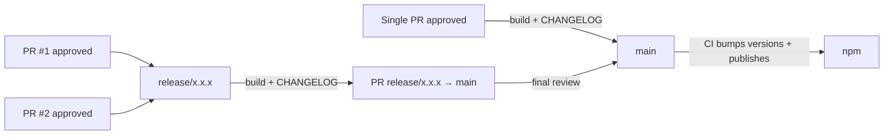

# MapsIndoors Web UI

This monorepo contains all UI projects for the MapsIndoors platform for Web. It is managed with [Lerna](https://lerna.js.org), which makes it easier to work with multiple connected projects in one repo, like this.

## Quickstart

The most interesting part of this repository is the Map Template. Get it up and running like so:

```zsh
$ git clone https://github.com/MapsPeople/web-ui.git
$ cd web-ui && npm install && npx lerna run build
$ cd packages/map-template && npm run start
```

Open your browser on [http://localhost:3000/](http://localhost:3000/) to check it out.

## How the repo is set up

The repo consists of these _packages_, which are all found in the `packages` folder:

- [`components`](https://github.com/MapsPeople/web-ui/blob/main/packages/components/README.md), the MapsIndoors Web Components found at [@mapsindoors/components](https://www.npmjs.com/package/@mapsindoors/components)
- [`map-template`](https://github.com/MapsPeople/web-ui/blob/main/packages/map-template/README.md), the MapsIndoors Map Template, a React app helping you get up and running fast and easy. It can be found at [@mapsindoors/map-template](https://www.npmjs.com/package/@mapsindoors/map-template)
- [`midt`](https://github.com/MapsPeople/web-ui/blob/main/packages/midt/README.md), i.e. MapsIndoors Design Tokens, a design library used as the foundation for UI styles across MapsIndoors. It can be found at [@mapsindoors/midt](https://www.npmjs.com/package/@mapsindoors/midt)

## A quick primer on Lerna

Built on top of [npm's Workspaces feature](https://docs.npmjs.com/cli/v9/using-npm/workspaces?v=true), [Lerna](https://lerna.js.org) makes sure you install the packages defined in each individual _package's_ `package.json`. In this case, from `components`, `map-template` and `midt`. At the same time, you install the latest version of each of those projects so you can work with them across your _packages_ in this repo. We often make changes to `components` we need for a feature in the `map-template` project. Using [Lerna](https://lerna.js.org), we don't have to deal with `npm link`, but can work on one feature across projects easily.

## Conventional Commits

We use, and heavily rely on, the use of [Conventional Commits](https://www.conventionalcommits.org/en/v1.0.0/).

Conventional Commits lets us write commits in a standardized fashion, no matter the contributor, and since we follow [Semantic Versioning](https://semver.org), we can keep everything in check more easily following the standards.

If your contribution to this repository doesn't follow these standards, it might be rejected, so please familiarize yourself with them before opening Pull Requests.

### Updating the CHANGELOG

When creating a new Pull Request, you must give it a label of `major`, `minor` or `patch` depending on the nature of the code. You can read more about it on the link mentioned above on `Semantic Versioning`.

When the Pull Request has been approved, the `CHANGELOG` file must be updated. If multiple projects have been worked on, the `CHANGELOG` for each project needs to be updated. For now, the label applies for all the projects that have been worked on (i.e. work has been done on both the `Map Template` and the `Components` folder, and the label is `minor`, then the `CHANGELOG` for both projects need to be updated with a minor change.)

## Release flow

Most Pull Requests are merged straight into `main` once approved. Use a `release/x.x.x` branch only when several Pull Requests need to ship together in one release.

Either way, every release must update the `CHANGELOG` of each package it changes (`packages/map-template/CHANGELOG.md`, `packages/components/CHANGELOG.md`) with an entry for the new version and date. It must also be built before it is merged (from the web-ui root folder level):

```zsh
$ npm i && npx lerna run build
$ cd packages/components && npm run build   # only if packages/components changed
```

`dist` is not committed, but the build regenerates files that are: `packages/components/src/components.d.ts`, each component's `readme.md`, and `packages/midt/build/`. If the build changes any of them, commit them.

For a single Pull Request, do all of this on that Pull Request's branch before it is merged.



### Shipping several Pull Requests together

1. Create the release branch from `main`. Pick the version from the highest PR label: bump the patch number if all PRs are `patch`, the minor number if any PR is `minor`, and the major number if any PR is `major`.
2. Change the base of each Pull Request to `release/x.x.x` and rebase it onto the release branch.
3. Merge each Pull Request into the release branch, **only once it is approved**. The release branch has no branch protection, so GitHub will not stop you from merging an unapproved Pull Request.
4. Open a Pull Request from `release/x.x.x` to `main`. Its title must follow Conventional Commits, e.g. `chore(release): x.x.x`.
5. On the release branch, run `npm i && npx lerna run build` from the repo root. If anything changed in `packages/components`, also run `npm run build` inside `packages/components`.
6. Update the `CHANGELOG` of every package the release changes (`map-template`, `components`) with one entry for the new version and date, combining the entries from each merged Pull Request. Rename any `[Unreleased]` section to the version and date.
7. Push the changes to `release/x.x.x` and ask a maintainer for a final look before merging to `main`.

Do not bump the versions in `package.json` by hand. CI does this after the release Pull Request is merged.
